

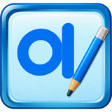&nbsp;&nbsp;
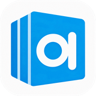&nbsp;&nbsp;

# 📝 OpenHAN

### 🇰🇷 100% 한국인이 만든 국산 워드프로세서

**친숙한 글쓰기, 더 많은 가능성.**

**HWP/HWPX 문서 호환 · 한글 단축키 · AI 비서와 맞춤법 · 로컬 AI 누끼 따기를 갖춘 한글 워드프로세서입니다.**

🪟 Windows · 🍎 macOS · 🤖 Android · 💎 v2.5.0 · 🎨 3가지 화면 테마 · ✨ AI · 📜 MIT

[English · README](README.en.md) · [📥 다운로드](https://github.com/ilhoon2025/OpenHAN/releases/tag/v2.5.0)

---

## 🇰🇷 Proudly Made in Korea

### 대한민국에서 시작한 새로운 문서 작성 경험

**OpenHAN은 100% 한국인이 직접 기획하고 개발한 대한민국의 오픈소스 워드프로세서입니다.**

한국 사용자의 문서 작성 환경을 이해하고, 누구나 쉽고 편리하게 사용할 수 있는 프로그램을 목표로 개발되었습니다.

익숙한 HWP/HWPX 문서 작업부터 AI 맞춤법 검사, 공문서체 변환, AI 이미지 배경 제거까지 문서 작성에 필요한 기능을 **PC와 휴대폰** 어디서나 쓸 수 있게 담았습니다.

**한국인이 만든 소프트웨어, 누구나 자유롭게 사용하는 워드프로세서.**

---

## 🆕 이번 버전에서 달라진 점

| | 내용 |
| :--- | :--- |
| ✨ **OpenHAN AI** | AI 비서, 맞춤법·띄어쓰기 검사와 자동 수정, 공문서체·논문체 변환, HWP 요약 카드 뷰어 |
| 🔑 **무료 AI 자동 전환** | Gemini · Groq · Mistral · Cerebras · OpenRouter · Pollinations(OpenHAN 키 내장 · 설정 없이 바로 사용) · 로컬 Ollama — 한도에 걸리면 다음 AI로 자동으로 넘어갑니다 |
| 🤖 **안드로이드 앱** | 휴대폰 전용 화면(앱 바 · 아래 서식 줄 · 기능 시트), 다른 앱에서 HWP를 OpenHAN으로 열기 |
| 🍎 **macOS 지원** | 신호등 창 단추, ⌘ 단축키, Finder에서 문서 열기 (Apple 실리콘·Intel 지원) |
| 💿 **설치 파일 제공** | Windows 설치 파일(Setup)과 설치 없이 실행하는 포터블 exe |
| 📂 **기본 앱 설정** | hwp · hwpx · ohan · txt · html을 두 번 눌러 OpenHAN으로 열기 |
| 🎨 **테마별 새 로고** | 2010 · 2018 · 2024 테마마다 그 시절 느낌의 로고, 2018 테마의 사선 모서리 탭 |

---

## ✨ 주요 기능

### 📄 HWP & HWPX 읽기/쓰기

HWP 5.0과 HWPX 문서를 열고 저장할 수 있으며, OpenHAN 고유 포맷 `.ohan`으로 에디터 형식을 보존할 수 있습니다.

OpenHAN에서 저장한 HWP/HWPX를 한컴오피스 한글 2024에서 열어 글꼴·크기·색, 셀 배경색, 병합된 표, 그림, 용지 크기가 그대로 나오는 것을 확인했습니다.

  

### 🎨 3가지 화면 테마

**2010**, **2018**, **2024** 테마 중 선택할 수 있습니다. 처음 실행할 때 고르고, 이후에는 **도구 → 환경 설정**에서 언제든 바꿀 수 있습니다.

  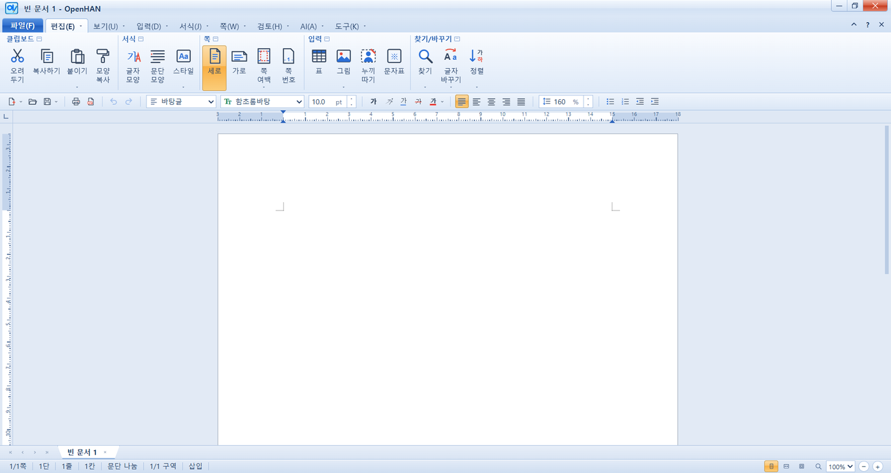 
  2010 — 하늘색 유리 그라데이션, 묶음 이름이 위에 붙은 도구 상자, 파란 '파일(F)' 탭

  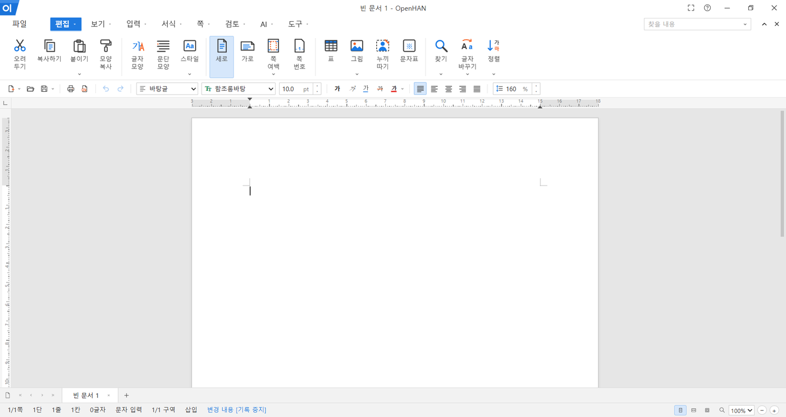 
  2018 — 파란색으로 채운 활성 탭, 왼쪽 위 사선 모서리 탭, '찾을 내용' 검색 칸

  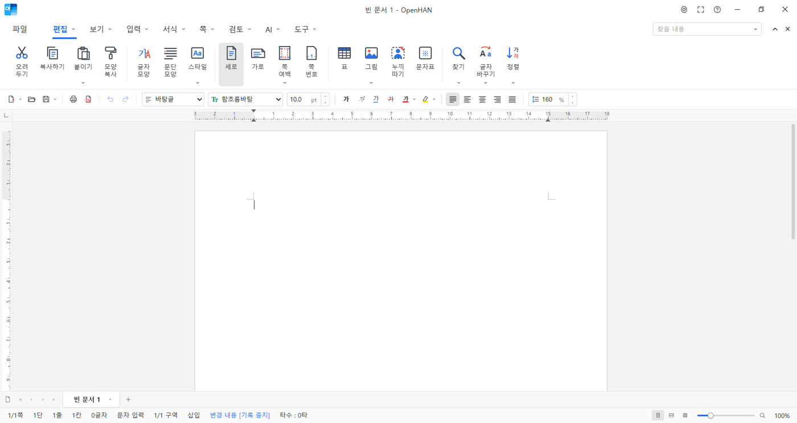 
  2024 — 밑줄 탭, 둥근 선택 상자, 타수와 확대 슬라이더가 있는 상황선

문서 페이지는 흰색으로 유지하면서 어두운 화면을 쓸 수 있고, 애니메이션 효과는 설정에서 끌 수 있습니다.

### ✨ OpenHAN AI

#### 🤖 무엇이든 하는 AI 비서

말로 시키면 앱이 직접 실행합니다. 보고서·공문·이력서 작성, 표 만들기, 서식·용지·테마 바꾸기, 맞춤법 고치기, 저장까지 할 수 있습니다. (`Ctrl+K, A`)

  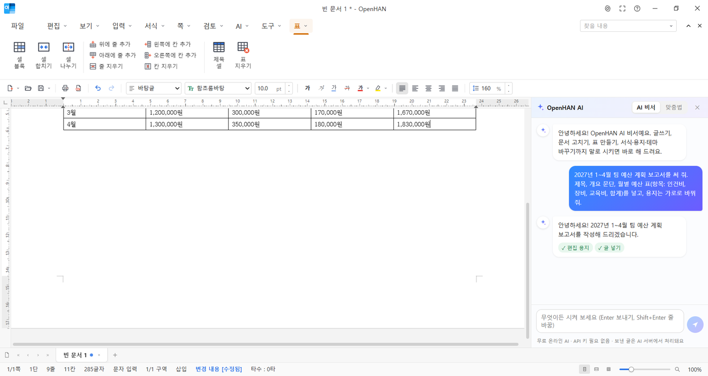

#### 🔤 맞춤법·띄어쓰기 검사 인포그래픽

`F8`을 누르면 AI가 문서를 검사하고 정확도 점수, 오류 유형별 막대, 고침 카드로 보여 줍니다. 틀린 곳은 문서에 물결선으로 표시되고, `Ctrl+F8` 또는 **모두 고치기** 버튼 하나로 한꺼번에 고칩니다.

  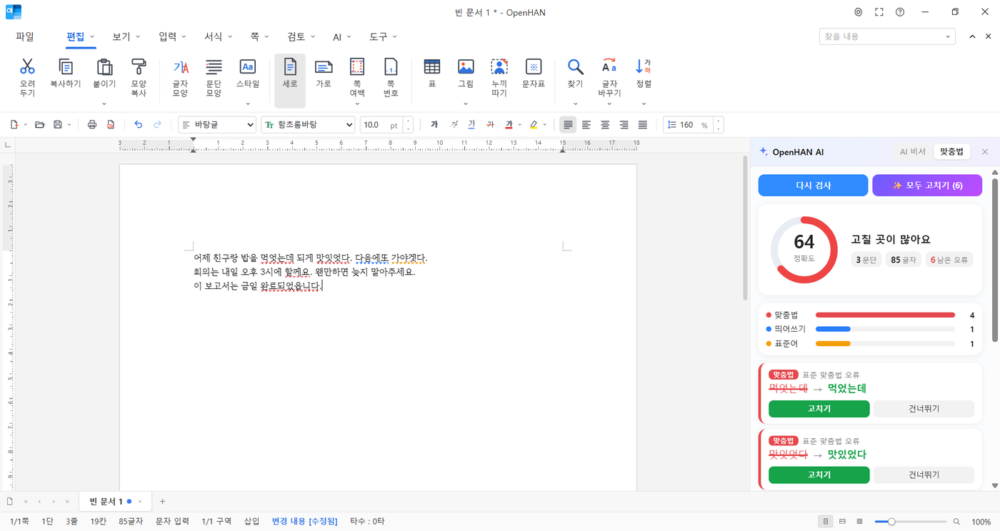

#### 🏛️ 공문서 / 논문 투고 스타일 변환기

대충 쓴 글을 버튼 하나로 **공문서체**(~함, ~바람), **학술 논문체**, 보고서체, 정중한 안내문, 쉬운 말로 바꿉니다. 원문과 결과를 나란히 비교한 뒤 적용할 수 있습니다.

  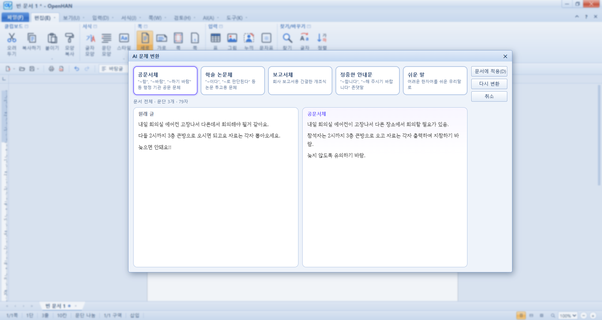

#### 📱 HWP 요약 & 미디엄 뷰어

수십 장짜리 HWP를 열지 않고도 휴대폰 카드처럼 **한 줄 요약 · 핵심 내용 · 장별 요약 · 그림 · 표**만 빠르게 훑어볼 수 있습니다. (`Ctrl+K, P`)

  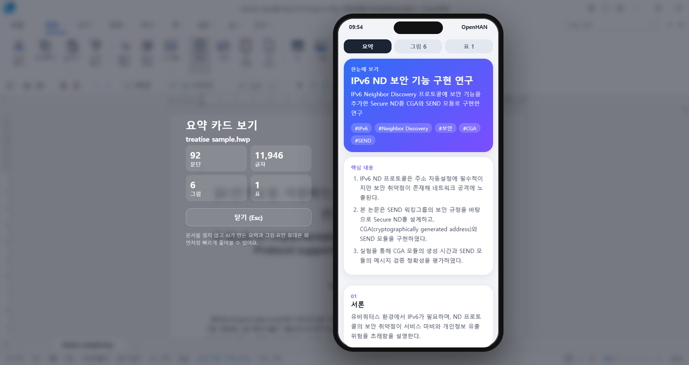

#### 🔑 무료 AI 자동 전환

완전히 무제한인 무료 클라우드 AI는 없기 때문에, 여러 곳의 **무료 API 키**를 넣어 두면 하나가 한도에 걸려도 자동으로 다음 AI로 넘어갑니다. 키가 없어도 Pollinations로 바로 쓸 수 있고, 이 PC에서 돌아가는 **로컬 AI(Ollama)**는 무제한이며 문서가 밖으로 나가지 않습니다.

  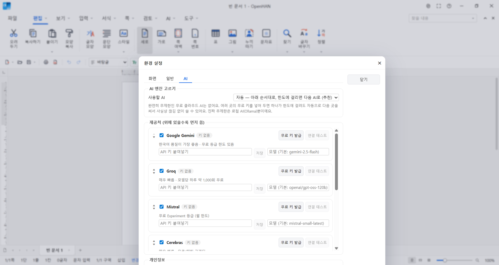

> API 키는 이 컴퓨터 계정의 암호화 저장소에 보관됩니다. AI 기능을 쓸 때만 해당 글이 그 순간 사용한 AI 제공처로 전달되니, 민감한 문서는 로컬 AI만 켜 두세요.

### 🖼️ 이미지 및 AI 배경 제거 (누끼 따기)

ONNX Runtime으로 **로컬에서** 실행되는 U²-Net 모델로 이미지 배경을 제거합니다. 마술봉, 지우개, 복원 붓으로 결과를 다듬고 문서에 넣거나 투명 PNG로 저장할 수 있습니다. 인터넷 연결 없이 동작합니다.

  

### 🗂️ 탭형 문서 작업과 시작 화면

여러 문서를 탭으로 열고, 시작 화면에서 가계부·주간 계획표·회의록·상장·이력서 등 12가지 서식으로 바로 시작할 수 있습니다.

  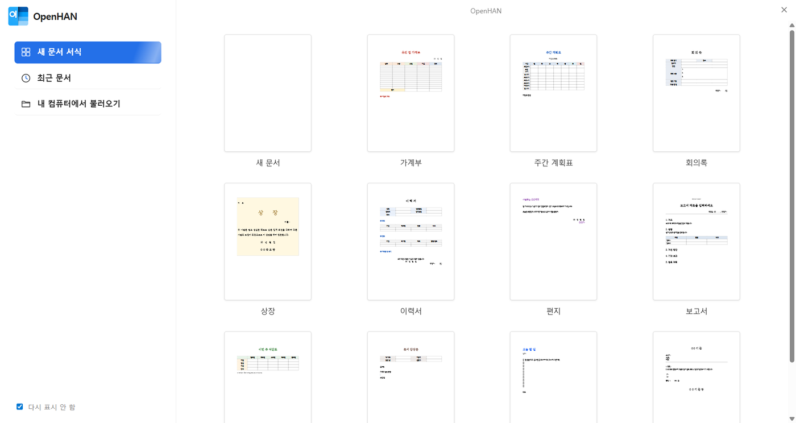

### ✍️ 문서 편집

글꼴, 크기, 색상, 자간, 줄 간격, 정렬(배분 정렬 포함), 들여쓰기, 표(셀 합치기·나누기), 그림, 문자표, 하이퍼링크, 쪽 나누기, 쪽 번호, 편집 용지(세로/가로, 여백 프리셋)를 지원합니다.

### ⌨️ 한글과 같은 단축키

`Alt+L` 글자 모양, `Alt+T` 문단 모양, `Ctrl+N, T` 표 만들기, `Ctrl+Y` 한 줄 지우기, `F5` 셀 블록 등 한글 사용자에게 익숙한 단축키를 그대로 씁니다. `F1`로 전체 목록을 검색할 수 있습니다.

### 🤖 안드로이드

같은 기능을 휴대폰 화면에 맞췄습니다. 위쪽 앱 바, 아래쪽 서식 줄, ⋮ 메뉴의 기능 시트로 HWP 편집·저장, AI, 누끼, 요약 카드를 쓸 수 있습니다. 저장한 문서는 공유 시트로 드라이브·메신저 등에 바로 보낼 수 있습니다.

  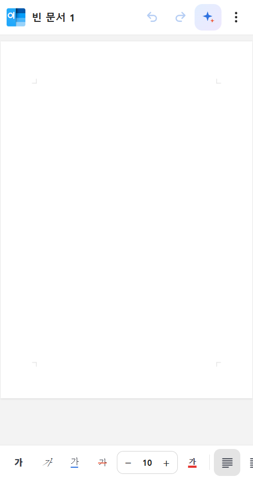&nbsp;&nbsp;
  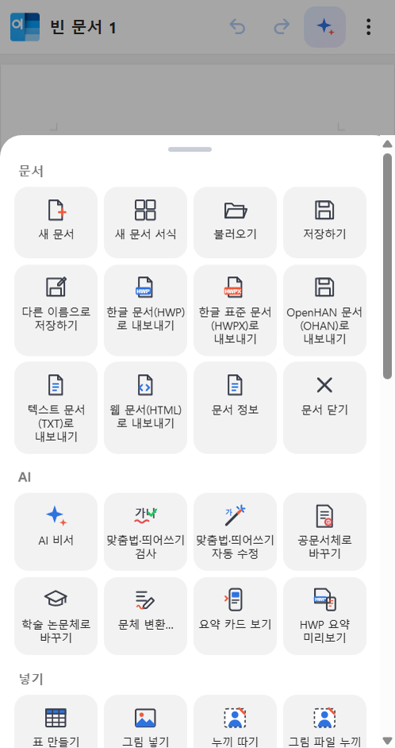

---

## 📥 다운로드 및 실행

[**Releases 페이지**](https://github.com/ilhoon2025/OpenHAN/releases/tag/v2.5.0)에서 내려받으세요.

| 플랫폼 | 파일 | 실행 방법 |
| :--- | :--- | :--- |
| 🪟 Windows (설치) | `OpenHAN-2.5.0-Setup.exe` | 실행 후 설치 위치를 고르면 시작 메뉴·바탕화면에 바로가기가 생깁니다 |
| 🪟 Windows (포터블) | `OpenHAN-2.5.0-Portable.exe` | 설치 없이 바로 실행합니다 |
| 🤖 Android | `OpenHAN-2.5.0-Android.apk` | 휴대폰으로 옮겨 설치합니다 (출처를 알 수 없는 앱 설치 허용 필요) |
| 🍎 macOS (Apple 실리콘) | `OpenHAN-2.5.0-mac-arm64.dmg` | M1~M4 Mac. 처음 열 때 **우클릭 → 열기** (또는 터미널에서 `xattr -cr /Applications/OpenHAN.app`) |
| 🍎 macOS (Intel) | `OpenHAN-2.5.0-mac-x64.dmg` | Intel Mac. 위와 같이 처음 한 번만 우클릭 → 열기 |

> **처음 실행할 때 Windows SmartScreen 경고가 뜰 수 있습니다.** 코드 서명 인증서가 없는 무료 프로그램이라 그렇습니다. **추가 정보 → 실행**을 누르세요.

### 📂 기본 앱으로 설정

처음 실행하면 hwp · hwpx · ohan · txt · html 파일을 OpenHAN으로 열지 물어봅니다. **설정하기**를 누르면 Windows 기본 앱 설정이 열리니 **기본값으로 설정**을 한 번 눌러 주세요. 나중에 **도구 → 환경 설정 → 일반**에서도 할 수 있습니다.

---

## 📖 빠른 시작

1. 🆕 **새 문서:** 시작 화면에서 서식을 고르거나 `Alt+N`
2. 📂 **열기:** `Ctrl+O`로 HWP, HWPX, OHAN, TXT, HTML 열기
3. ✍️ **편집:** 서식 도구로 글을 꾸미고 표나 그림 넣기
4. ✨ **AI:** `Ctrl+K, A`로 AI 비서를 열어 "회의록 써 줘", "공문서체로 바꿔 줘"처럼 시키기
5. 🔤 **맞춤법:** `F8` 검사, `Ctrl+F8` 자동 수정
6. 🪄 **누끼 따기:** 그림을 고르고 `Ctrl+Shift+K`
7. 💾 **저장:** `Ctrl+S`로 HWP, HWPX, OHAN 중 선택

  

8. 📤 **공유:** PDF로 내보내거나 `Ctrl+P`로 인쇄
9. 🎨 **설정:** **도구 → 환경 설정**에서 테마, AI, 기본 앱 설정

---

## 📁 지원 포맷

| 형식 | 열기 | 저장 / 내보내기 |
| :--- | :---: | :---: |
| HWP 5.0 (`.hwp`) | ✅ | ✅ |
| HWPX (`.hwpx`) | ✅ | ✅ |
| OpenHAN (`.ohan`) | ✅ | ✅ |
| 일반 텍스트 (`.txt`) | ✅ | ✅ 내보내기 |
| HTML (`.html`, `.htm`) | ✅ | ✅ 내보내기 |
| PDF (`.pdf`) | — | ✅ 내보내기 (데스크톱) |

### 문서 호환성 안내

HWP 3.0 이하, 암호로 보호된 HWP, 배포용 HWP는 지원하지 않습니다.

머리말/꼬리말, 각주, 도형, 표 캡션은 아직 읽거나 쓰지 않습니다. 일부 OpenHAN 전용 서식(예: 글머리표, 인용)은 HWP/HWPX로 저장할 때 일반 문단으로 바뀌므로, 모든 서식을 보존하려면 **OHAN 형식**을 사용하세요.

  

---

## ⌨️ 유용한 단축키

| 동작 | 단축키 |
| :--- | :--- |
| 🆕 새 문서 / 새 문서 서식 | `Alt+N` / `Ctrl+Alt+N` |
| 📂 열기 · 💾 저장 | `Ctrl+O` · `Ctrl+S` |
| 🖨️ 인쇄 | `Ctrl+P` |
| 🔎 찾기 / 바꾸기 | `Ctrl+F` / `Ctrl+H` |
| ✍️ 글자 / 문단 모양 | `Alt+L` / `Alt+T` |
| 📊 표 만들기 · 🖼️ 그림 넣기 | `Ctrl+N, T` · `Ctrl+N, I` |
| 🧹 한 줄 지우기 | `Ctrl+Y` |
| 📐 편집 용지 | `F7` |
| ✨ AI 비서 | `Ctrl+K, A` |
| 🔤 맞춤법 검사 / 자동 수정 | `F8` / `Ctrl+F8` |
| 🏛️ 공문서체 / 논문체 변환 | `Ctrl+K, G` / `Ctrl+K, R` |
| 📱 요약 카드 (현재 문서 / HWP 파일) | `Ctrl+K, S` / `Ctrl+K, P` |
| 🪄 누끼 따기 | `Ctrl+Shift+K` |
| 🖥️ 전체 화면 · ❓ 단축키 목록 | `F11` · `F1` |

macOS에서는 `Ctrl` 대신 `⌘`도 쓸 수 있습니다.

---

## 🛠️ 사용 기술

| 분야 | 기술 |
| :--- | :--- |
| 데스크톱 애플리케이션 | Electron |
| 안드로이드 애플리케이션 | Capacitor |
| 사용자 인터페이스 | React |
| 문서 편집 엔진 | Tiptap / ProseMirror |
| HWP/HWPX 처리 | 한컴 공개 문서 형식을 참고한 자체 구현 · fflate · cfb |
| AI 비서 · 맞춤법 · 요약 | OpenAI 호환 API (Gemini · Groq · Mistral · Cerebras · OpenRouter · Pollinations · Ollama) |
| AI 배경 제거 | U²-Net · ONNX Runtime (로컬) |

해외 오픈소스 기술을 활용하되, **OpenHAN 애플리케이션의 기획과 개발은 한국인이 직접 수행했습니다.**

---

## ✉️ 지원 및 버그 제보

사용 중 문제가 발생하면 GitHub 저장소의 **Issues** 탭에 보고해 주세요.

- OpenHAN 버전과 플랫폼 (Windows / Android / macOS 버전)
- 문제 재현 단계
- 기대한 결과와 실제 동작
- AI 관련 문제라면 사용한 AI 제공처

문서 호환성 문제는 개인정보를 제거한 예제 파일을 첨부해 주세요.

---

## 📜 라이선스 & 크레딧

OpenHAN 패키지는 **MIT 라이선스**를 선언합니다. 번들된 타사 구성요소는 각각의 라이선스를 유지합니다.

| 구성요소 | 라이선스 |
| :--- | :--- |
| OpenHAN | MIT |
| U²-Net | Apache-2.0 |
| cfb | Apache-2.0 |
| ONNX Runtime | MIT |
| Tiptap / ProseMirror | MIT |
| fflate | MIT |
| Capacitor | MIT |
| Electron · React | MIT |

OpenHAN은 독립적인 오픈소스 프로젝트이며 (주)한글과컴퓨터와 관련이 없습니다. '한글', 'Hancom'은 해당 회사의 상표입니다.

  

---

### 🇰🇷 PROUDLY MADE IN KOREA

**100% Korean-Developed**

### 📝 OpenHAN

**당신의 말, 당신의 작업 공간.**

친숙한 글쓰기, 더 많은 가능성.

대한민국에서 시작한 새로운 문서 작성 경험.

**Windows · macOS · Android · Version 2.5.0 · MIT License**

